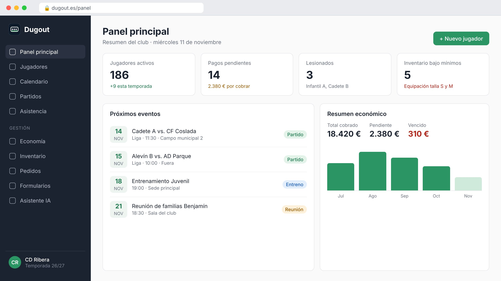
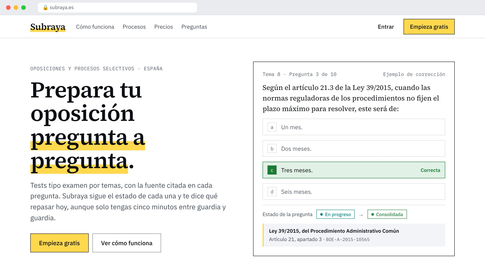

## Sobre mí

Ingeniero informático por la Universidad de Extremadura. Trabajo en software para aviónica de defensa: Ada, C++, modelado SysML y procesos DO-178C. Fuera del trabajo construyo productos web con React, Supabase e IA.

## Qué hago

## Proyectos destacados

<table>
<tr>
<td width="50%" valign="top">

<h3><a href="https://dugout.es">Dugout</a></h3>
SaaS para gestionar clubes de fútbol: plantillas, cuotas, inventario de equipaciones por tallas, panel de administración y un asistente de IA con Claude.
  <code>React</code> <code>TypeScript</code> <code>Supabase</code> <code>Tailwind</code>
</td>
<td width="50%" valign="top">

<h3><a href="https://subraya.es">Subraya</a></h3>
Tests de oposiciones en los que cada pregunta cita su fuente: documento, página y texto literal. Exámenes con las reglas de cada convocatoria. Hoy cubre Bombero de la Diputación de Cuenca y del Consorcio de Alicante.
  <code>Next.js</code> <code>Prisma</code> <code>PostgreSQL</code> <code>Python</code>
</td>
</tr>
</table>

## Tecnologías

## Actividad

## Contacto

Escríbeme por [LinkedIn]([https://www.linkedin.com/in/TU-USUARIO/](https://www.linkedin.com/in/eduardo-pe%C3%B1a-sanguino-48729b12b/) o prueba [Dugout](https://dugout.es).
